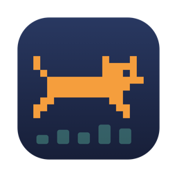
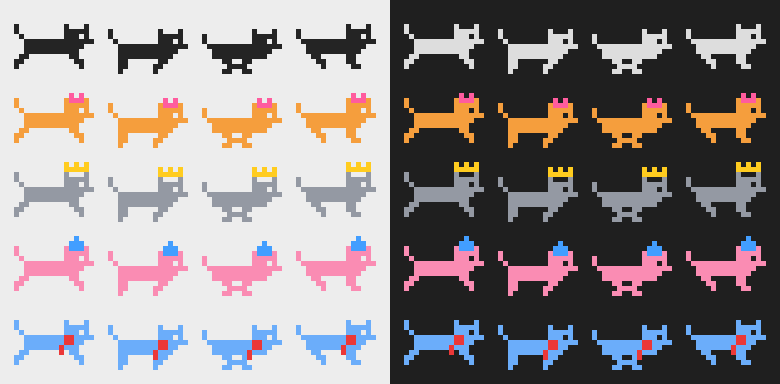
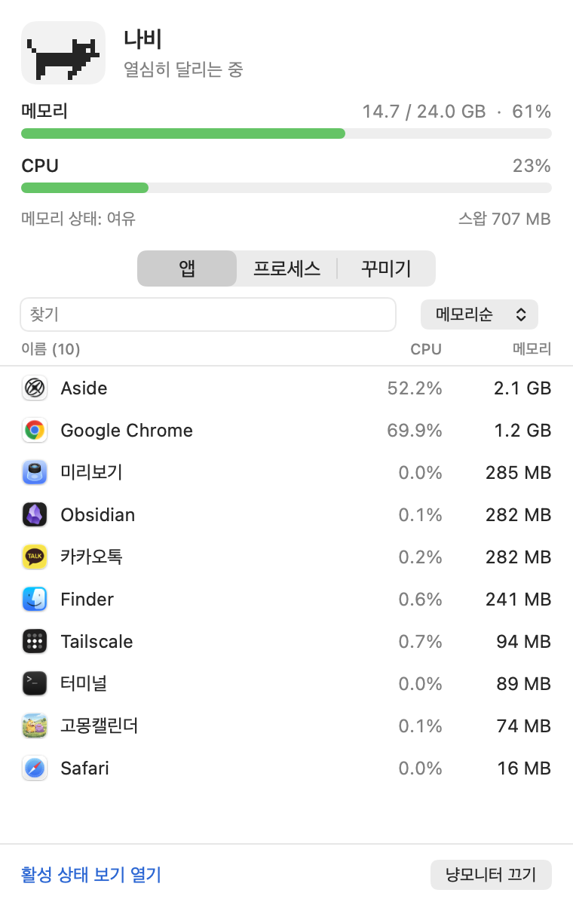
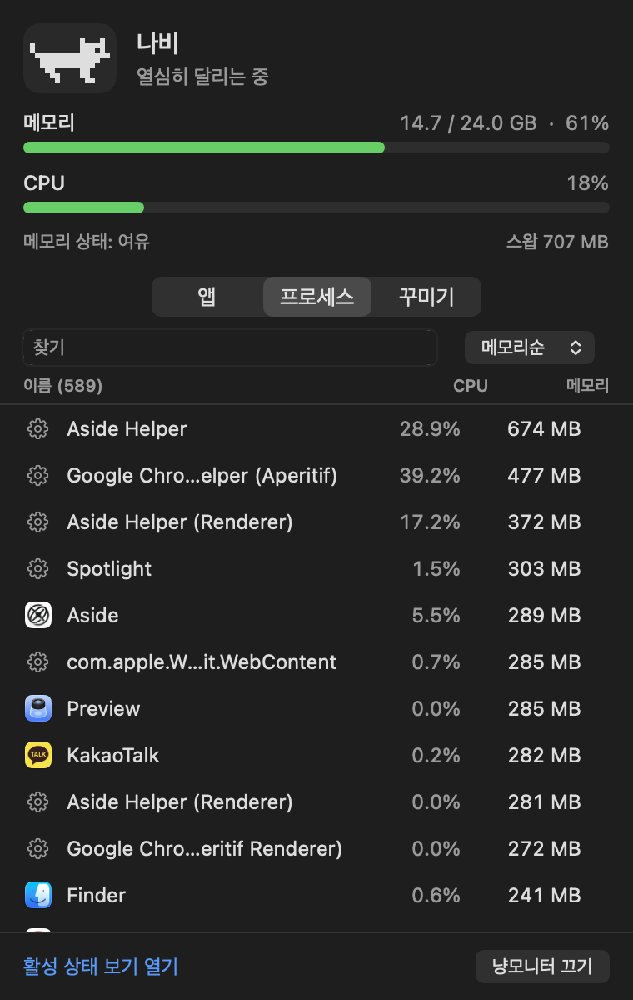
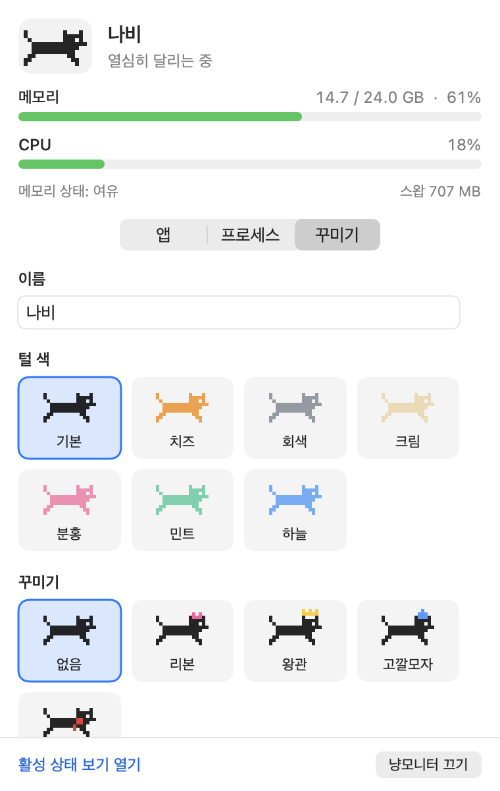

<p align="center"></p>

<h1 align="center">냥모니터 (NyangMonitor)</h1>

<p align="center">
맥 메뉴바에서 고양이가 달려요.<br>
메모리를 많이 쓰면 열심히, 여유로우면 천천히.<br>
고양이를 누르면 작업관리자가 열려요.
</p>

<p align="center"></p>

## 다운로드

1. [최신 릴리스](https://github.com/gold9-app/nyang-monitor/releases/latest)에서 `NyangMonitor.zip` 받기
2. 압축 풀고 `NyangMonitor.app`을 **응용 프로그램** 폴더로 옮기기
3. 처음 한 번은 아래처럼 열기 (애플 유료 개발자 서명이 없어서 맥이 한 번 막아요)
   - 앱을 더블클릭 → "열 수 없음" 창이 뜨면 **완료**
   - **시스템 설정 → 개인정보 보호 및 보안** 맨 아래 → **"그래도 열기"** 누르기
   - 또는 터미널에서 한 줄: `xattr -cr /Applications/NyangMonitor.app`
4. 메뉴바 오른쪽 위에 고양이가 나타나요

macOS 13 (Ventura) 이상, 애플 실리콘 / 인텔 맥 모두 됩니다.

## 기능

<p>



</p>

**메뉴바 고양이**
- 메모리(또는 CPU) 사용량에 따라 달리는 속도가 바뀜
- 옆에 사용률 % 숫자

**작업관리자**
- 메모리 / CPU 게이지, 메모리 상태(여유 · 주의 · 위험), 스왑
- 앱 탭: 실행 중인 앱 (크롬처럼 도우미 프로세스가 많은 앱은 합쳐서 계산)
- 프로세스 탭: 내 계정으로 돌아가는 프로세스 전체
- 찾기, 메모리순 · CPU순 · 이름순 정렬
- 줄에 마우스를 올리면 **종료 / 강제 종료** (강제 종료는 두 번 눌러야 실행)

**꾸미기**
- 이름, 털 색 7가지, 리본 · 왕관 · 고깔모자 · 목도리
- 달리는 기준: 메모리 / CPU / 더 바쁜 쪽
- 메뉴바 숫자 켜고 끄기, 맥 켤 때 자동 시작

## 직접 빌드하기

Xcode 없이 커맨드라인 도구만 있으면 돼요 (`xcode-select --install`).

```bash
git clone https://github.com/gold9-app/nyang-monitor.git
cd nyang-monitor
./build.sh install   # 빌드해서 /Applications 에 설치하고 실행
./build.sh release   # dist/NyangMonitor.zip 만들기
```

## 파일 구성

| 파일 | 하는 일 |
|---|---|
| `Sources/CatArt.swift` | 픽셀 고양이 그림, 장식, 앱 아이콘 |
| `Sources/SystemStats.swift` | 메모리 / CPU 측정, 달리기 속도 계산 |
| `Sources/ProcessStore.swift` | 앱 · 프로세스 목록, 종료 |
| `Sources/Views.swift` | 작업관리자 창, 꾸미기 화면 |
| `Sources/AppDelegate.swift` | 메뉴바 아이콘, 애니메이션 |

## 라이선스

MIT
